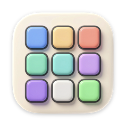
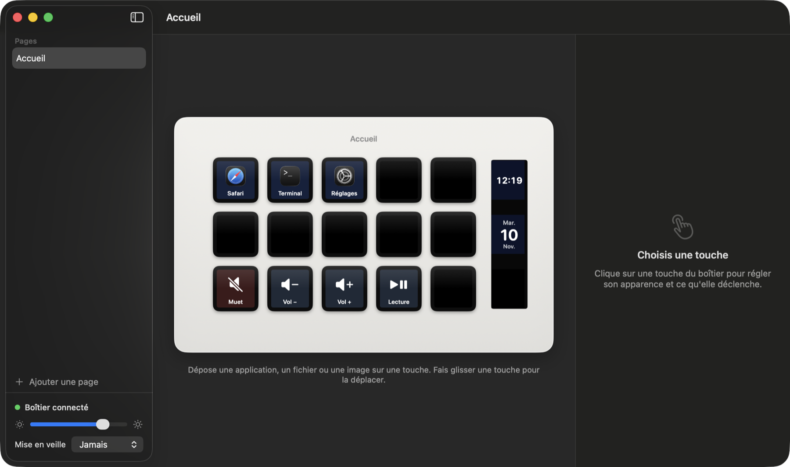

<p align="center"></p>

# DeckPilot

A small native macOS app that drives a **MiraBox StreamDock 293SV3** without the vendor
software. Each key gets a title, an icon, a background and an action; the app talks to the
deck directly over USB HID.

I bought this deck, wanted a simple native app for it on my Mac, and ended up writing one.
If you own the same deck and are in the same spot, this may save you the work. If you own
a different MiraBox or Ajazz deck, the protocol notes below may still be useful.



## What it does

- **Keys you configure by looking at them.** The window shows the deck as it sits on your
  desk. Click a key to edit it, drop an app, a file or an image on it, drag one key onto
  another to swap them.
- **Actions.** Open an app, a website, a file or a folder; run a shell command or a
  Shortcuts shortcut; send a keyboard shortcut or type text; volume, mute, play/pause,
  next and previous track; switch page; change the deck brightness.
- **Appearance.** Title (colour, size, position), icon (SF Symbol, emoji, image, animated
  GIF, or an app's own icon), plain or gradient background.
- **Animations.** Pulse, spin, bounce and blink on any icon, and animated GIFs. They are
  played from the Mac, frame by frame.
- **Live content.** A clock and a date, handy on the three display-only cells of the strip.
- **Pages.** As many pages of keys as you want, switchable from a key or from the menu bar.
- **Stays out of the way.** It lives in the menu bar, reconnects when the deck is plugged
  back in, can dim the deck after a period without a key press, and uses about 0.2 % CPU
  when nothing is animated.

## Supported hardware

Tested on one device only: MiraBox StreamDock 293SV3, USB `6603:1014`, 15 keys plus a
strip of 3 display-only cells.

Other decks of the same family speak a very similar protocol, but their key numbering,
image size and rotation differ. Supporting one means adding a layout in
`Sources/StreamDockKit/DeckLayout.swift` and its USB identifiers in `HIDDeck.swift`. I have
not tried any.

## Download

Get `DeckPilot-<version>.dmg` from the
[latest release](https://github.com/ezeeFlop/DeckPilot/releases/latest), open it and drag
DeckPilot to Applications. The app is a universal binary (Apple Silicon and Intel), signed
with a Developer ID and notarized by Apple. It needs macOS 14 or later.

Quit the vendor's StreamDock app first: two programs cannot drive the deck at once.

DeckPilot keeps itself up to date with [Sparkle](https://sparkle-project.org). On its
second launch it asks whether it may check for updates automatically; if you agree, it
reads the release feed of this repository about once a day. That is its only network
activity of its own. You can check by hand or turn the checks off from its menu bar icon.

## Build from source

You need macOS 14 or later and Xcode (Swift 5.10 or later).

```sh
git clone https://github.com/ezeeFlop/DeckPilot.git
cd DeckPilot
scripts/build-app.sh            # builds build/DeckPilot.app
open build/DeckPilot.app
scripts/build-app.sh --install  # builds, then copies it to /Applications
swift test                      # runs the tests
```

Keyboard shortcuts, typed text and the play/next/previous keys need the Accessibility
permission (System Settings › Privacy & Security › Accessibility). macOS asks the first
time you use one. The build script signs with your Apple Development certificate when you
have one, so the permission survives rebuilds; otherwise it signs ad hoc and macOS will
ask again after each rebuild.

`scripts/release.sh` produces the distributed disk image: universal build, Developer ID
signature with the hardened runtime, notarization, stapling, then the update feed
(`appcast.xml`). It needs a Developer ID certificate, three variables (`APPLE_ID`,
`APPLE_PASSWORD`, `TEAM_ID`) in the environment or in an untracked `.env` file, and the
Sparkle signing key in the keychain. A fork that ships its own builds must put its own
feed address and public key in `scripts/build-app.sh`.

Your settings live in `~/Library/Application Support/DeckPilot/config.json`, with images
in the `images` folder next to it.

## The protocol, in short

Everything goes through the vendor HID interface (usage page `0xFFA0`): 1024-byte output
reports, 512-byte input reports, report ID 0.

Every command is one output report, zero-padded, starting with `CRT 00 00`:

| Bytes after `CRT 00 00` | Effect |
|---|---|
| `DIS` | wake the screen |
| `LIG 00 00` + percent | brightness, 0 to 100 |
| `BAT` + size (4 bytes, big-endian) + slot | announces a JPEG; its bytes follow in 1024-byte reports |
| `STP` | show what was sent |
| `CLE 00 00 00` + slot | clear one slot (`FF` clears all) |
| `HAN` | sleep |
| `CONNECT` | keep-alive, every 10 s |
| `CLE 00 00 DC` | end of session |

Key presses arrive as input reports: `ACK` at bytes 0–2, `OK` at bytes 5–6, the key number
at byte 9 and the state at byte 10 (`1` pressed, `0` released).

Images are 96 × 96 JPEGs, rotated a quarter turn counter-clockwise before sending. Slots
are numbered top to bottom, column by column, starting from the right:

```
13 10  7  4  1 | 16
14 11  8  5  2 | 17
15 12  9  6  3 | 18
```

16 to 18 are the display strip. Its glass shows only the right 82 pixels of each image.

The full notes, with what was read in the code and what was seen on the device, are in
[docs/protocol-notes.md](docs/protocol-notes.md) (in French).

## Limits

- **One deck model.** See above.
- **The interface is in French.**
- **Key releases are not always reported** by the deck, for a reason I have not found.
  Actions therefore fire on press, and there is no long-press action.
- **The boot logo is not supported.** The command exists (`LOG`), but it writes to the
  deck's permanent memory and I have not tried it.
- **No plug-in system.** Actions are the ones listed above.

## How the code is laid out

| Folder | Role |
|---|---|
| `Sources/StreamDockKit` | protocol, slot layout, image encoding, USB HID link |
| `Sources/DeckCore` | configuration model and storage |
| `Sources/DeckPilot` | the SwiftUI app: key rendering, actions, interface |

## Credits

- [4ndv/mirajazz](https://github.com/4ndv/mirajazz) and
  [4ndv/opendeck-akp153](https://github.com/4ndv/opendeck-akp153), whose open
  implementations documented most of the protocol first.
- [MiraboxSpace/StreamDock-Device-SDK](https://github.com/MiraboxSpace/StreamDock-Device-SDK),
  the official SDK. The commands above were confirmed by reading its transport library
  with Ghidra, then by trying them on the device.

- [Sparkle](https://sparkle-project.org) for updates.

DeckPilot is a personal project. It is not affiliated with or endorsed by MiraBox, and it
contains none of their code.

## License

[MIT](LICENSE)
